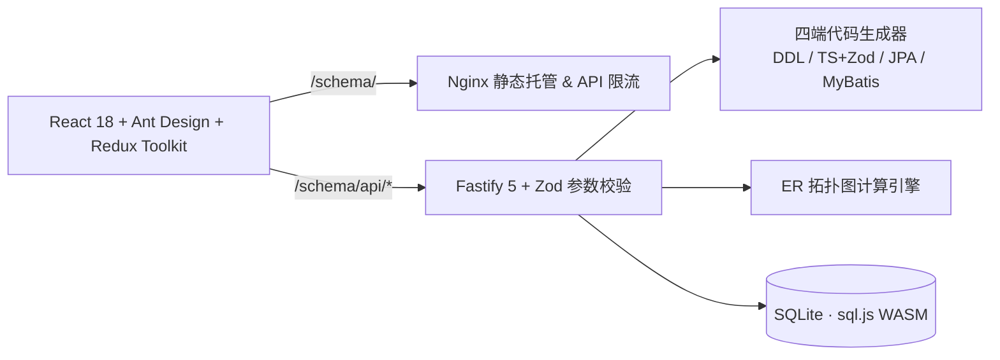

# 星枢研发舱（Schema Cockpit）

[](https://github.com/calmjade/schema-cockpit/actions/workflows/ci.yml)


多项目表结构资产管理、交互式 ER 关系拓扑与四端生产代码生成平台。

- 🌐 **在线体验**：[https://calmjade.cn/schema/](https://calmjade.cn/schema/)
- 🏠 **作者作品集**：[https://calmjade.cn](https://calmjade.cn)

---

## 系统架构



---

## 核心能力

- **研发总览与全局字段检索**：跨项目汇总表结构与字段资产规模，支持任意表名、字段名与注释的全局模糊检索，实时追踪研发审计动态。
- **表结构工作台与代码生成器**：维护表与字段元数据（主键、可空性、默认值、索引、外键引用），实时生成 **MySQL 8 DDL**、**TypeScript + Zod Schema**、**Java Spring Data JPA `@Entity`** 与 **MyBatis CRUD XML**。
- **交互式 ER 关系拓扑图**：基于 SVG 实现的可拖拽、可缩放实体关系画布，自动解析 `ref_table` 外键连线。
- **需求与变更排期看板**：研发需求与受影响数据表联动管理，支持内联状态流转与审计留痕。

---

## 快速启动与测试

```bash
# 后端（端口 8092）与 Vitest 单测
cd backend && pnpm install && pnpm test && pnpm dev

# 前端（端口 9022）
cd frontend && pnpm install && pnpm dev
```

---

## 作者与许可

- **作者**：曹杰 / caojie (`calmjade`) · calmjade@foxmail.com
- **GitHub**：https://github.com/calmjade ｜ **Gitee**：https://gitee.com/jiejie12315
- **协议**：[MIT License](./LICENSE)
